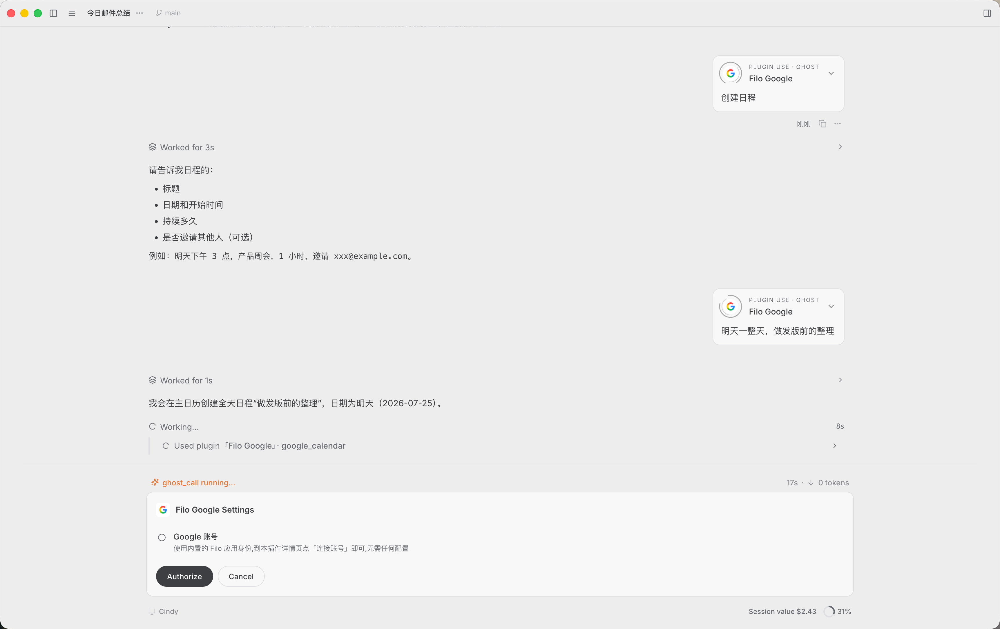
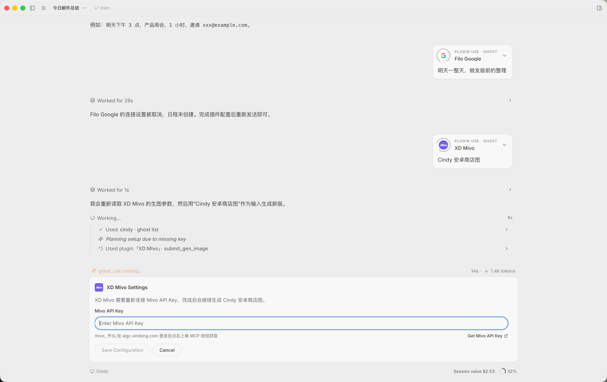

# 插件 Setup Runtime 技术设计

> 状态：Desktop 已实现并通过自动化与 Electron 真机视觉验收；外部授权完成回流待联调；Mobile 独立后续  
> 关联 Issue：[makecindy/cindy#136](https://github.com/makecindy/cindy/issues/136)  
> 适用范围：Desktop 的 `ghost_list` / `ghost_info` / `ghost_call`、插件配置宿主、聊天交互卡
> 不改变：插件沙箱权限、Secret 存储边界、Agent system prompt

## 1. 背景与根需求

当前宿主已经能根据 `ghost.json` 的 `setup.requires` 判断插件是否就绪，但检查只用于插件页的「使用」入口。Agent 在聊天中调用 `ghost_call` 时仍可能直接进入附件授权、目录票据、沙箱启动和插件派发，最后才因缺少 OAuth、Secret、Connection 或插件参数而失败。

本功能把 setup 检查提升为 `ghost_call` 的通用运行时门：

1. Agent 调用插件前，Host 确定性检查该插件的 setup；
2. 未就绪时，在输入框位置展示与 Ask 卡片一致的 Setup 卡片；
3. Agent 可依据 Host 暴露的需求和受控 Action 编排说明、步骤和顺序；
4. Host 执行内联 Secret 收单、OAuth、打开插件设置、管理连接等受控 Action；
5. 任一配置来源保存成功后，Host 立即重新判定并更新卡片；
6. 全部就绪后，继续同一个挂起的 `ghost_call`，不唤醒 LLM、不要求 Agent 重试。

插件不需要各自实现一套聊天卡回调。普通 `source: "user"` Secret 可由 Host 根据 manifest 声明直接生成内联表单；已有 `settings.js` 仍通过宿主 `/oauth`、`/kv`、`/secrets`、`/connections` 接口承担详情页的长期管理。客户端内 Provider / 模型配置也走同一 Host 状态变更机制。Core 不维护插件 id / Provider id 路由表：插件只需通过 manifest 声明 Host 能力，所属 Host 子系统继续作为 readiness 的唯一权威来源。

## 2. 用户体验契约

### 2.1 呈现

- Setup 卡片复用 Ask 卡片的容器、尺寸、位置和视觉 token，替换聊天输入框；Setup 始终展开，不提供右上角收起/恢复交互。
- Setup 不是 `ask_user_question`，不会把用户操作或配置内容发送给模型。
- 卡片标题中的插件身份由 Host 提供，不采信 Agent 文本：
  - 插件 icon；
  - `插件名 设置`。
- 卡片正文、步骤标题、步骤说明和顺序可由 Agent 编排，但必须引用 Host 提供的 requirement 和 action。
- 未满足的 `any_of` 组必须完整展示所有可执行配置路径，由用户选择其中一种；Agent 和 Host fallback 都不得只取组内第一项。卡片正文沿用 Ask 的最大高度，内容溢出时在正文区域纵向滚动，Header 与 Action 区保持可见。
- `any_of` 的多条路径使用同一个平坦纵向列表和 hairline 分隔，不渲染 radio、清单圆点或中性的 `Pending` 标签，避免暗示用户需要先选中或完成全部路径；每条路径仍完整展示，不折叠成 Provider selector，也不按具体插件或 Provider 定制布局。
- 单路径不再额外嵌套带边框卡片。`inline_form` 统一按「字段标题 → 输入框与对应 Action 同行 → 辅助信息」呈现；校验错误原位替换字段说明，Host 声明的外链保持在同一辅助行右侧。更多路径继续使用相同列表结构，并由正文最大高度统一收口。
- 单字段内联配置只展示一层主说明：优先 Agent `intro`，缺失时才使用 step description；字段 label / hint 由 Host 展示，UI 不重复渲染同义的 step title / description。
- manifest 的 `network.secrets[].url` 若存在，Host 在字段旁展示本地化的「获取凭证」辅助入口；URL 不由 Agent 提供，也不进入 Agent 可回传的 plan。
- 主 Action 随步骤状态显示，例如「授权」「授权中」「等待授权」「检查中」「重试」「已完成」。
- 次级 Action 为「取消」。取消只终止当前挂起调用，不回滚已经完成的配置，也不影响其他等待同一插件的调用。
- 卡片在 setup 结束前保持展开，避免配置流程被隐藏或产生额外恢复入口。

### 2.2 通用状态

单步骤统一使用以下状态，不按 Gmail、Art 等具体插件分叉：

```ts
type PluginSetupStepPhase =
  | "pending"
  | "action_running"
  | "waiting_external"
  | "verifying"
  | "satisfied"
  | "failed"
  | "cancelled";
```

卡片终态：

- `ready`：所有 requirement 已由 Host 重新判定为满足，卡片关闭并恢复原调用；
- `cancelled`：用户取消当前调用；
- `failed`：Action 执行失败但仍可重试；
- `unavailable`：插件被卸载、停用、工具消失或配置声明变化，终止原调用并返回结构化错误。

### 2.3 典型流程

OAuth 插件：

```text
[icon] Google Gmail 设置
使用 Google Gmail 需要连接您的 Google 账号
[授权] [取消]

授权 → 授权中 → 等待浏览器完成 → 检查中 → 已完成
```

客户端内配置型插件：

```text
[icon] Cindy Art 设置
使用 Cindy Art 需要先配置可用的图片模型
[打开设置] [取消]

打开设置 → 等待保存 → 检查中 → 已完成
```

文案只是 Agent 编排示例；是否完成始终以 Host 的 setup assessment 为准。

简单填入型插件：

```text
[icon] XD Mivo 设置
使用 XD Mivo 需要配置 Mivo API Key
[密码输入框]
[获取 Mivo API Key ↗]
[保存配置] [取消]

保存配置 → 正在保存… → 正在检查… → 已完成
```

该输入只存在于本地 Desktop 当前组件的临时状态。插件详情页仍保留主动替换、清除和复杂管理入口，但调用当下不再要求用户离开对话。

### 2.4 Desktop 真机效果

OAuth 授权：



内联 Secret 配置：



## 3. 职责边界

### 3.1 Agent

- 从 `ghost_info` / `ghost_list` 读取 Host 返回的 setup assessment；
- 在 `ghost_call` 中可选提交 setup plan；
- 决定对用户展示的步骤、顺序、标题和说明；
- 只能引用 Host 已允许的 requirement ref 和 action id；
- 不能读取 Secret、Token 或 OAuth 返回值；
- 不能声明某一步已经完成；
- setup 等待期间不会被再次唤醒。

### 3.2 Host / Main

- 提供可信的插件 id、名称和 icon；
- 从 manifest 和真实存储计算 setup assessment；
- 生成允许执行的 action 白名单；
- 校验 Agent setup plan，非法或缺失 plan 时生成安全默认 plan；
- 在任何附件授权、目录票据、沙箱启动、卡片注册或插件派发前执行 setup gate；
- 执行 Action、订阅配置变更、重新判定、广播卡片更新；
- ready 后继续原 `ghost_call`；
- 配置变化后再次验证插件存在、enabled、workdir policy、tool existence 和 setup；
- manifest 与 setup 引用漂移时，运行时 gate fail-closed 并返回结构化错误；
- 保证 Token / Secret 不进入 Agent、Ghost、interaction / pending snapshot、会话历史、日志、分析事件或远程通道；内联 Secret 只允许短暂存在于本地 Desktop 输入组件和 trusted Renderer → Main 专用 IPC。

### 3.3 插件设置页

- 继续使用现有 `settings.html` / `settings.js`；
- 继续通过宿主受控端点保存 OAuth、KV、Secret 和 Connection；
- 作为用户主动管理、替换、清除和复杂配置的长期入口；简单 Secret 的调用前收单由 Host Setup 卡完成；
- 不直接操作聊天卡状态；
- 保存成功即结束插件侧职责，Host 持久化层统一发出变更事件。

### 3.4 Renderer

- 复用 Ask 卡片外壳，不复用 Ask 的答案模型；
- 仅渲染 Host 下发的插件身份、经校验的 plan 和权威步骤状态；
- 普通 Action 点击只传 `requestId`、`actionId` 和期望 revision；
- 内联 Secret 只保存在组件临时 state，并经本地专用 IPC 一次性交给 Main；不得进入 session store、interaction decision、pending snapshot 或持久化消息；
- 忽略低于当前 revision 的旧更新；
- 提交成功、取消、request / revision 替换和组件卸载时清空临时输入；
- 不读取已保存凭证，不自行判定 setup 完成。

## 4. 协议模型

### 4.1 Host assessment

`ghost_info` / `ghost_list` 在插件条目中返回动态 `setup`。未配置内容只包含引用、展示信息、状态和可执行 Action，不包含值。

```ts
type PluginSetupRequirementKind =
  "oauth" | "secret" | "connection" | "plugin_config" | "client_config";

type PluginSetupRequirementState = "missing" | "expired" | "satisfied";

interface PluginSetupAllowedAction {
  id: string;
  kind:
    | "oauth_connect"
    | "inline_form"
    | "open_plugin_settings"
    | "manage_connection"
    | "open_client_settings";
  form?: {
    fields: [
      {
        id: "value";
        type: "secret";
        label: string;
        description?: string;
        externalLink?: {
          url: string; // Host 从已校验的 manifest 声明生成；MCP 边界剥离
        };
        required: true;
        maxLength: number;
      },
    ];
  };
}

interface PluginSetupAssessment {
  state: "ready" | "required";
  revision: number;
  groups: Array<{
    id: string;
    mode: "any_of";
    items: Array<{
      ref: string;
      kind: PluginSetupRequirementKind;
      label: string;
      description?: string;
      state: PluginSetupRequirementState;
      actions: PluginSetupAllowedAction[];
    }>;
  }>;
}
```

约束：

- groups 之间为 all-of，group 内为 any-of，与现有 `setup.requires` 语义一致；
- `revision` 由 Host 单调递增；
- `ref` 是稳定关联引用，不是可执行路径或授权凭据；
- `satisfied` 条目可用于 Agent 理解 any-of 当前状态，但不暴露配置值；
- Action 按 `kind` 由 Renderer 做四语言按钮文案，不在 assessment 中下发未本地化文案；
- Host 可将现有 `secret`、`connection`、`kv` 声明映射成以上通用类型；
- 客户端内 Provider / 模型能力映射为 `client_config`，不要求插件伪造 Secret 或 KV；
- `client_config` 按 manifest 声明的 Host capability 匹配，不按插件 id 或具体 Provider id 分支。新增使用既有 Host capability 的插件时，无需改 Setup Runtime Core。

### 4.2 Agent setup plan

`ghost_call` 增加可选 `setup_plan`。这是展示计划，不是授权或完成声明。

```ts
interface AgentPluginSetupPlan {
  assessmentRevision: number;
  intro?: string;
  steps: Array<{
    id: string;
    requirementRefs: string[];
    title: string;
    description: string;
    actionId: string;
  }>;
}
```

Host 校验：

- `requirementRefs` 必须存在于本次最新 assessment；
- `actionId` 必须属于这些 requirement 允许的 Action；
- plan 必须覆盖所有尚未满足 group 中的每个可执行 item；Agent 可调整顺序与文案，但不能隐藏某个合法配置路径；
- 字段长度、步骤数和字符集受限；
- Agent 不得提供插件名、icon、step phase、revision 或完成状态；
- 校验失败不执行任意 Action，Host 回落到按 assessment 生成的默认 plan。

这次工具 schema 扩展会改变一次 MCP 工具定义和 prompt cache 前缀；上线后 schema 保持稳定。插件安装、配置和状态变化只影响 `ghost_info` / `ghost_list` 的查询返回，不再动态改变工具定义。

### 4.3 Runtime interaction

Setup 使用现有 interaction push / dismissed 基础设施挂载和清理卡片，但使用独立 `plugin_setup` kind 和 Action 命令，不走 Ask 的 `answers`：

```ts
interface PluginSetupInteraction {
  kind: "plugin_setup";
  requestId: string;
  sessionId: string;
  ghost: {
    id: string;
    name: string;
    iconDataUrl?: string;
  };
  revision: number;
  intro?: string;
  steps: Array<{
    id: string;
    title: string;
    description: string;
    phase: PluginSetupStepPhase;
    action?: PluginSetupAllowedAction;
    errorMessage?: string;
  }>;
}
```

Renderer → Main：

```ts
type PluginSetupCommand =
  | {
      kind: "run_action";
      requestId: string;
      actionId: string;
      expectedRevision: number;
    }
  | {
      kind: "cancel";
      requestId: string;
      expectedRevision: number;
    };

interface PluginSetupInlineSubmit {
  requestId: string;
  actionId: string;
  expectedRevision: number;
  value: string;
}
```

- `run_action` / `cancel` 继续走现有通用 interaction resolve；
- `inline_form` 不进入通用 decision，Desktop Renderer 通过 `maker:plugin-setup:submit-inline` 专用 invoke 提交；
- Main 只接受 trusted app frame，按 `requestId + actionId + expectedRevision` 重新绑定最新 assessment 和 manifest 声明后写入保险库；
- Secret 值只在本地输入组件和这次 invoke 参数中短暂存在，不进入 interaction snapshot、pending snapshot、session store、消息历史、日志、分析或远程传输；
- pending snapshot 只允许保存脱敏字段 schema。reload / 切会话后卡片可恢复，但输入框必须为空，用户需要重新输入；
- 辅助 URL 必须来自当前 manifest 的 `network.secrets[].url`，满足安装期 `https`、无内嵌凭证校验；Renderer 再做同样的协议/长度校验后才展示；
- 专用 invoke 不加入 device-link allowlist。远程端可看到等待态，但输入和主 Action 禁用，并提示回到权威 Desktop 完成。

Main → Renderer：

- 首次 `INTERACTION_REQUEST` 挂载卡片；
- setup update push 使用完整 snapshot，而不是 Renderer 合并局部 patch；
- ready / cancel / unavailable 使用 `INTERACTION_DISMISSED` 清理；
- `getPendingInteractions` 或等价 pending snapshot 必须包含当前 setup，供窗口重载、切会话和后加入窗口恢复。

## 5. Main Runtime

### 5.1 Preflight 顺序

`ghost_call` 的顺序必须是：

```text
校验 ghost / workdir policy（普通调用同时校验 tool；grant_only 忽略 tool）
→ subscribe setup change
→ initial evaluate
→ ready：继续
→ required：挂起 coordinator + 展示卡片
→ ready / cancel / unavailable
→ 再次校验 ghost / workdir policy / setup（普通调用同时重验 tool）
→ grant_only：建立附件预授权并返回（不执行插件）
→ 附件授权 / dir ticket / save ticket
→ sandbox spawn
→ card registration
→ plugin dispatch
```

禁止在 setup ready 前产生授权记忆、目录票据、沙箱副作用或插件调用。已经进入 dispatch 的调用不因后续配置变化自动重试。

`grant_only` 只建立附件交接，不执行插件工具，并保持忽略 `tool` 的调用语义。非 Full Access 下，用户确认会建立人工 `ghost-grant`；本地 Full Access 下则只建立 `ghost-tool-grant` 取件引用，不弹卡，也不形成降档后仍生效的人工永久授权。两种路径都必须先通过 Host-authoritative setup gate，禁止未配置插件提前获得任何媒体引用。旧插件页 `GhostSetupStatus` 投影可保留兼容行为；真正的运行时 gate 遇到缺失声明或无法解析的 requirement 时不得 fail-open。

### 5.2 Coordinator

每个未就绪的调用创建 waiter，保存：

- `requestId`、`sessionId`、`ghostId`、`tool`；
- 原始且已经完成输入结构校验的调用参数；
- Host 校验后的 setup plan；
- 当前 assessment revision；
- 超时、取消和 session cleanup。

Coordinator 必须先订阅 change bus，再做 initial evaluate，避免“刚保存配置但事件发生在订阅前”的丢失竞态。

同一个插件的多个 waiter 可共享底层状态 watcher，但每个 waiter 独立：

- 卡片和 session 生命周期；
- 取消；
- 原调用恢复；
- 错误返回。

取消一个 waiter 只 detach 当前 waiter，不终止 OAuth、不回滚配置、不取消其他 waiter。

### 5.3 Change bus

所有 setup 相关持久化成功路径统一 emit：

```ts
interface PluginSetupChanged {
  ghostId: string;
  source: "oauth" | "kv" | "secret" | "connection" | "manifest" | "host_config";
  ref?: string;
  revision: number;
}
```

必须覆盖：

- OAuth client 保存、账号连接、重连、删除；
- `/kv` 保存；
- `/secrets` 保存或删除；
- `/connections` 新增、修改、删除；
- 插件安装、更新、卸载、唤醒、沉睡；
- Host Provider / 模型配置保存。

插件自身的 OAuth、KV、Secret、Connection 和 manifest 变化携带 `ghostId`，只唤醒对应插件的 waiter。Host Provider / 模型等共享配置没有可靠